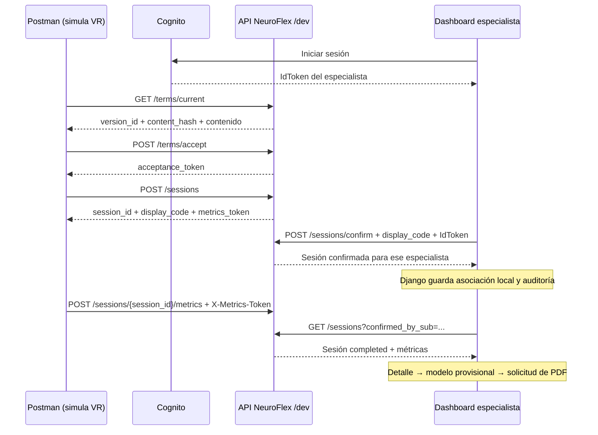

# Probar NeuroFlex VR sin visor

`VR Session Flow - Simulacion.postman_collection.json` es una colección importable de Postman. Conserva la colección YAML original en `collections/`; contiene un flujo nuevo con comprobaciones de respuestas, encadenamiento de variables y once métricas ficticias. No incluye contraseñas ni tokens.

## Uso en Postman

1. Importa `VR Session Flow - Simulacion.postman_collection.json` con **Import > Files**.
2. En las variables de la nueva colección, revisa `base_url`, `cognito_region` y `cognito_client_id`. Se precargaron los identificadores de desarrollo de la captura. `cognito_user_pool_id` no hace falta para `InitiateAuth`.
3. Configura `software_username` y `software_password` con la cuenta de prueba **Specialist** que debe recibir la sesión, mediante valores locales o un environment privado. No exportes las credenciales.
4. Ejecuta **solo la carpeta `01 - Flujo VR simulado`**, en orden, con una iteración. No ejecutes toda la colección: la carpeta `02` contiene una operación administrativa independiente.
5. Comprueba que el paso 6 encuentra la sesión con `status=completed` y las once métricas enviadas. `session_id` queda en las variables de la colección.

Cada corrida crea una sesión distinta en la API de desarrollo. Las métricas son sintéticas y no corresponden a un paciente. La aceptación de términos del paso 2 forma parte de esta simulación técnica.

## Flujo completo



En el Runner, Postman hace también las llamadas del software y obtiene su propio IdToken en el paso 0. En el uso real, Cognito autentica al especialista en el dashboard; no hace falta que el visor tenga usuario y contraseña del profesional.

| Paso | Método y ruta | Autorización | Cuerpo / resultado utilizado |
| --- | --- | --- | --- |
| 0 | `POST https://cognito-idp.{{cognito_region}}.amazonaws.com/` | `X-Amz-Target: AWSCognitoIdentityProviderService.InitiateAuth`, `Content-Type: application/x-amz-json-1.1` | `USER_PASSWORD_AUTH`, `ClientId`, `USERNAME`, `PASSWORD`; guarda `AuthenticationResult.IdToken` y extrae `sub` para consultar |
| 1 | `GET {{base_url}}/terms/current` | Sin bearer en este flujo /dev | Guarda `version_id` y `content_hash`; el usuario real debe poder leer los términos |
| 2 | `POST {{base_url}}/terms/accept` | Sin bearer en este flujo /dev | `version_id`, `content_hash`, `application_version`; guarda `acceptance_token` |
| 3 | `POST {{base_url}}/sessions` | Sin bearer en este flujo /dev | `acceptance_token`; guarda `session_id`, `display_code`, `metrics_token` |
| 4 | `POST {{base_url}}/sessions/confirm` | `Authorization: Bearer {{id_token}}` | `display_code`; confirma para el usuario autenticado |
| 5 | `POST {{base_url}}/sessions/{{session_id}}/metrics` | `X-Metrics-Token: {{metrics_token}}` | Once métricas de `metricas_ejemplo.json` |
| 6 | `GET {{base_url}}/sessions?confirmed_by_sub={{confirmed_by_sub}}` | `Authorization: Bearer {{id_token}}` | Verifica identidad de la sesión, `completed` y las once métricas |

Los POST de la API NeuroFlex usan `Content-Type: application/json`. No son intercambiables los tres tokens: `id_token` identifica al especialista, `acceptance_token` acredita la aceptación para crear sesión y `metrics_token` autoriza el envío de métricas de esa sesión. `display_code` es el código de vinculación mostrado al profesional; `session_id` identifica el registro.

La consulta de sesiones puede estar paginada. Si el paso 6 no encuentra la sesión y hay `next_cursor`, repite el GET agregando `&cursor=<next_cursor>`. El runner de Python recorre hasta veinte páginas automáticamente. El nombre `cursor` sigue el cliente Django; no se ha probado una segunda página con el servidor.

## Probar también el dashboard

Para una prueba completa de la aplicación, ejecuta manualmente 0–3 en Postman, entra al dashboard como el **mismo especialista**, ingresa `display_code` en **Confirmar sesión** y después ejecuta 5–6 en Postman. El paso 4 de Postman se omite en este caso porque lo hace Django.

Esto importa porque confirmar directamente contra la API no ejecuta `confirm_and_associate_session()` en Django: no crea su fila local `SpecialistSession` ni su evento de auditoría. La lista remota se consulta por `confirmed_by_sub`, pero la asociación local se utiliza en otros procesos como el caché y los informes.

El `.env` del dashboard de esta copia contiene valores de ejemplo para la URL de API y el client ID. Para conectarlo al mismo entorno, configura `NEUROFLEX_API_BASE_URL` y `COGNITO_CLIENT_ID` con los valores de desarrollo que aparecen en la colección. Comprueba además que `FAKE_SESSIONS` no esté en `1`: en ese modo se devuelven sesiones de demostración en lugar de consultar el servidor.

## Desde métricas hasta resultado e informe

1. El especialista abre la lista y el detalle; Django consulta la API usando su IdToken y su `sub`.
2. Cuando la sesión está completada, Django muestra las métricas y conserva una copia local si existe su asociación `SpecialistSession`.
3. Para vincular la sesión, el especialista ingresa **solo el código de sesión**. No se solicita mano dominante ni se añade un campo obligatorio a las requests.
4. El modelo usa los siete tiempos y `TipoEscena` de las métricas. Se eliminó la lectura y validación de mano dominante; el pipeline congelado resuelve automáticamente su antigua columna mediante la imputación ya ajustada. No se utiliza aunque esté presente en metadatos antiguos.
5. Con entradas completas, el pipeline estima el rango de objetos correctos (`bajo`, `medio`, `alto`) y probabilidades. Es un resultado provisional, no un diagnóstico.
6. El especialista solicita el PDF; un administrador aprueba o rechaza; después de la aprobación, el especialista puede descargarlo. La aprobación no otorga al administrador acceso a los informes clínicos.

## Crear términos es una operación aparte

No necesitas crear ni publicar términos en cada sesión: `GET /terms/current` ya devolvió la versión `0.0.1` en la prueba del 4 de noviembre de 2026.

La carpeta `02` tiene un POST opcional a `/terms/versions`, con `admin_id_token`, `terms_version`, título y contenido. Se genera el JSON mediante `JSON.stringify()` para soportar comillas, saltos de línea y barras. Se crea con `published=false` para no cambiar los términos vigentes durante una prueba de sesiones. La publicación se gestiona por separado con el flujo administrativo del proyecto.

## Hallazgo verificado en la API de desarrollo

La colección original utiliza `/software/sessions/confirm`, que devolvió HTTP **403**. Con la misma cuenta del grupo `Specialist`, `/sessions/confirm` devolvió **400 Invalid display_code** al enviar un cuerpo vacío: la ruta existe y valida el código. La colección nueva utiliza esta última, que coincide con el cliente Django. No se modificó el código de Django.

La primera prueba creó la sesión sintética `8055fb32-93db-4df6-a901-8ffd3205c548` y se detuvo en el 403 de la ruta original; no se enviaron métricas a ese registro ni se borró automáticamente. El resultado de la última ejecución se guarda en `ultima_prueba.json`, sin contraseñas ni tokens.

Con la ruta corregida se completó la sesión **`190f80cb-6989-45c2-a067-950883b998f2`**: términos 200, Cognito 200, aceptación 201, creación 201, confirmación 200, envío de métricas 200 y consulta final 200. La consulta devolvió `status=completed` y coincidencia exacta de las once métricas. Se usó la cuenta de prueba del grupo `Specialist`; no se crearon ni publicaron términos. Esta prueba valida la API; la confirmación por código y el cálculo sin mano dominante se comprueban por separado con las pruebas de Django.

## Repetir sin Postman

Desde la raíz del repositorio, en PowerShell:

```powershell
.venv/Scripts/python.exe postman/run_dev_flow.py --username <usuario-specialist>
```

La contraseña se solicita de forma oculta y queda solo en memoria. El runner crea una sesión, confirma, envía las métricas y consulta hasta encontrar el registro completado. Requiere acceso de red a Cognito y a la API. Para otro entorno `/dev`, admite `NEUROFLEX_DEV_BASE_URL`, `COGNITO_CLIENT_ID`, `COGNITO_REGION` y `CONFIRM_PATH` como variables de entorno; no pongas contraseñas en la línea de comandos.

Para regenerar la colección y verificar sus scripts sin hacer llamadas de red:

```powershell
.venv/Scripts/python.exe postman/build_collection.py
node postman/verify_collection.cjs
```

La prueba local verifica encadenamiento de variables, interrupción ante errores HTTP, desafíos Cognito, presencia de métricas y escape de JSON. No reemplaza una ejecución contra la API. Las suites Django relacionadas son `clinical_sessions.tests.test_external_session_client` y `clinical_sessions.tests.test_specialist_session_service`.
